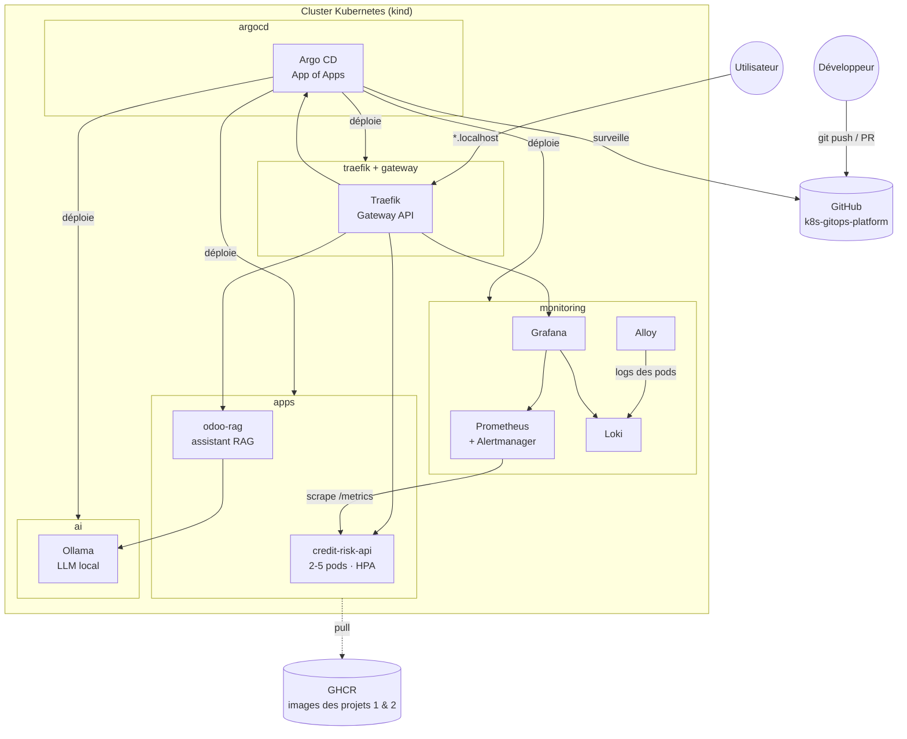
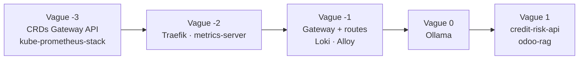
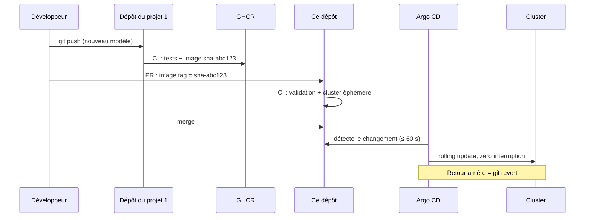

# ☸️ K8s GitOps Platform — plateforme Kubernetes pour services d'IA

[](https://github.com/Marshall006/k8s-gitops-platform/actions/workflows/ci.yml)


> Une plateforme Kubernetes **pilotée entièrement par Git** (GitOps), qui
> déploie, expose, supervise et journalise deux services d'IA :
> l'API de scoring de crédit ([projet 1](https://github.com/Marshall006/mlops-credit-risk))
> et l'assistant RAG Odoo ([projet 2](https://github.com/Marshall006/rag-agent-assistant)).
> Toute la plateforme se crée en **une commande**, et chaque commit est testé
> sur un **vrai cluster éphémère** dans la CI.

**Compétences démontrées :** Kubernetes · GitOps (Argo CD, App of Apps, sync
waves) · Helm (chart générique réutilisable) · Gateway API (Traefik) ·
observabilité (Prometheus, Grafana, Alertmanager, Loki, Alloy) · alerting ·
sécurité des workloads (non-root, NetworkPolicy, seccomp) · haute
disponibilité (HPA, PDB, rolling updates) · tests d'infrastructure de bout en
bout en CI.

---

## Sommaire

1. [GitOps en deux phrases](#-gitops-en-deux-phrases)
2. [Architecture](#️-architecture)
3. [Stack technique détaillée](#-stack-technique-détaillée)
4. [Ordre de déploiement](#-ordre-de-déploiement-sync-waves)
5. [Le chart ml-service](#-le-chart-ml-service)
6. [Observabilité](#-observabilité)
7. [Démarrage rapide](#-démarrage-rapide)
8. [Déployer une nouvelle version](#-déployer-une-nouvelle-version-le-flux-gitops)
9. [CI : tester l'infrastructure](#-ci--tester-linfrastructure)
10. [Structure du dépôt](#-structure-du-dépôt)
11. [Choix techniques](#-choix-techniques)

---

## 💡 GitOps en deux phrases

Le dépôt Git décrit **l'état souhaité** du cluster : quelles applications,
quelles versions, quelle configuration. **Argo CD** compare en permanence le
cluster à Git et corrige tout écart. On ne fait plus jamais
`kubectl apply` à la main : on fait une **pull request**.

Bénéfices : historique complet (qui a changé quoi, quand), retour arrière par
`git revert`, revue de code sur l'infrastructure, et un cluster que l'on peut
reconstruire à l'identique en une commande.

## 🏗️ Architecture



## 🧰 Stack technique détaillée

| Catégorie | Technologie | Rôle dans le projet | Pourquoi ce choix |
|---|---|---|---|
| **Orchestration** | **Kubernetes** (kind) | Exécute et répare les conteneurs | Standard de l'industrie ; kind = un vrai cluster dans Docker, gratuit |
| **GitOps** | **Argo CD** 3.x | Synchronise le cluster avec Git, auto-réparation, prune | Outil GitOps le plus adopté, interface web claire |
| **Pattern** | App of Apps + sync waves | Une application racine déclare toutes les autres, dans l'ordre | Une seule application à amorcer, ordre de déploiement maîtrisé |
| **Packaging** | **Helm** | Chart générique `ml-service` + chart racine + charts tiers | Réutilisable : un nouveau service = un fichier de valeurs |
| **Entrée HTTP** | **Traefik** + **Gateway API** | Route `*.localhost` vers les services (HTTPRoute) | ingress-nginx est archivé depuis mars 2026 ; Gateway API = successeur officiel d'Ingress |
| **Métriques** | **Prometheus** (kube-prometheus-stack) | Collecte `/metrics` des APIs, de Kubernetes et des nœuds | Référence de la supervision cloud native |
| **Alertes** | **Alertmanager** + PrometheusRule | Service down, erreurs 5xx, latence p95, redémarrages | Alertes versionnées avec le code |
| **Tableaux de bord** | **Grafana** | Tableau de bord de l'API, chargé automatiquement depuis Git | Dashboards as code |
| **Logs** | **Loki** + **Grafana Alloy** | Collecte et stockage des logs de tous les pods | Alloy remplace Promtail (déprécié) ; Loki s'interroge depuis Grafana |
| **LLM** | **Ollama** | Modèle `qwen2.5:3b` servi dans le cluster | IA locale, aucune donnée ne sort |
| **Sécurité** | securityContext, NetworkPolicy | Non-root, seccomp, capabilities supprimées, réseau en zéro confiance | Bonnes pratiques Pod Security « restricted » |
| **Autoscaling** | **metrics-server** | Expose le CPU/mémoire des pods aux HPA | Absent de kind : sans lui, l'autoscaling est aveugle |
| **Résilience** | HPA, PDB, RollingUpdate, probes | Autoscaling 2→5 pods, zéro interruption pendant les mises à jour | Prêt pour la production |
| **CI** | **GitHub Actions** + kind | Lint, rendu, validation de schéma, cluster éphémère, tests de bout en bout | Chaque commit est déployé et testé pour de vrai |
| **Validation** | **kubeconform** + CRDs catalog | Vérifie chaque manifeste contre le schéma Kubernetes | Détecte les erreurs avant le cluster |

## 🌊 Ordre de déploiement (sync waves)

Argo CD déploie par **vagues** : chaque vague attend que la précédente soit
saine.



Pourquoi cet ordre ? Traefik et les applications créent des `ServiceMonitor`
et des `HTTPRoute` : ces types d'objets doivent **exister** (CRDs) avant
qu'on puisse les créer. Sans vagues, le premier déploiement échoue au hasard.

## 📦 Le chart `ml-service`

Un **chart Helm générique** pour n'importe quel service d'IA HTTP. Déployer un
nouveau service revient à écrire ~20 lignes de valeurs.

| Ressource | Rôle |
|---|---|
| `Deployment` | Pods non-root, seccomp `RuntimeDefault`, capabilities supprimées, startup/readiness/liveness probes, mise à jour sans interruption (`maxUnavailable: 0`) |
| `Service` | Adresse stable interne |
| `HTTPRoute` | Exposition via la Gateway API |
| `HorizontalPodAutoscaler` | Ajoute des pods au-delà de 70 % de CPU |
| `PodDisruptionBudget` | Garde au moins 1 pod pendant les maintenances |
| `NetworkPolicy` | Seuls Traefik et Prometheus peuvent joindre les pods |
| `ServiceMonitor` | Prometheus collecte `/metrics` |
| `PrometheusRule` | 4 alertes : service down, erreurs 5xx > 5 %, latence p95 > 500 ms, redémarrages en boucle |
| `ConfigMap` dashboard | Tableau de bord Grafana importé automatiquement |

Exemple : [`apps/credit-risk-api/values.yaml`](apps/credit-risk-api/values.yaml).

## 📈 Observabilité

Les trois piliers sont couverts :

| Pilier | Outil | Exemple |
|---|---|---|
| **Métriques** | Prometheus | `rate(http_requests_total{service="credit-risk-api"}[5m])` |
| **Logs** | Loki (via Alloy) | `{namespace="apps", app="credit-risk-api"}` dans Grafana > Explore |
| **Alertes** | Alertmanager | `CreditRiskApiHighLatency` si p95 > 500 ms pendant 10 min |

Le tableau de bord **« Credit Risk API — production »** affiche : requêtes par
seconde, taux d'erreurs, latence p95, pods prêts, trafic par endpoint, latence
p50/p95/p99 de `/predict`, codes HTTP et mémoire des pods.

## 🚀 Démarrage rapide

**Prérequis** (Linux, macOS ou WSL2) : Docker, [kind](https://kind.sigs.k8s.io),
[kubectl](https://kubernetes.io/docs/tasks/tools/), [Helm](https://helm.sh).
Mémoire : 8 Go libres (16 Go avec Ollama).

```bash
git clone https://github.com/Marshall006/k8s-gitops-platform.git
cd k8s-gitops-platform
make up          # cluster + Argo CD + toute la plateforme (~10 min la 1re fois)
make test        # tests de fumée de bout en bout
make passwords   # identifiants Argo CD et Grafana
```

| Interface | URL |
|---|---|
| Argo CD | http://argocd.localhost |
| Grafana | http://grafana.localhost |
| API de crédit (Swagger) | http://credit-risk.localhost/docs |
| Assistant Odoo | http://rag.localhost |

Les adresses `*.localhost` pointent automatiquement vers ta machine : aucune
configuration DNS n'est nécessaire.

```bash
make down        # supprime tout
```

## 🔄 Déployer une nouvelle version (le flux GitOps)



Les images sont référencées par un **tag immuable** (`sha-<commit>`), jamais par
`latest` : on sait toujours exactement quel code tourne.

## ✅ CI : tester l'infrastructure

| Job | Ce qu'il vérifie |
|---|---|
| **validate** | `helm lint --strict`, rendu de tous les manifestes, validation de schéma (kubeconform), résolution des versions des charts tiers et rendu avec **nos** valeurs |
| **images** | Les images des projets 1 et 2 existent et sont publiques |
| **e2e** | Crée un cluster kind, exécute `bootstrap.sh` sur **le commit testé**, attend que les 10 applications Argo CD soient *Synced* et *Healthy*, puis lance les tests de fumée |

Les tests de fumée vérifient le parcours complet : requête via la Gateway →
réponse de l'API → **métriques présentes dans Prometheus** → **alertes
chargées** → **logs présents dans Loki**.

## 📁 Structure du dépôt

```
k8s-gitops-platform/
├── bootstrap/
│   ├── bootstrap.sh          # cluster + Argo CD + application racine
│   ├── wait-for-apps.sh      # attente + diagnostic détaillé en cas d'échec
│   ├── smoke-test.sh         # tests de bout en bout
│   ├── kind-config.yaml      # cluster local, port 80 exposé
│   └── argocd-values.yaml
├── gitops/root/              # App of Apps (chart Helm)
│   ├── values.yaml           # versions des charts, applications activées
│   ├── values-local.yaml     # profil poste de travail (avec Ollama)
│   ├── values-ci.yaml        # profil CI (LLM factice)
│   └── templates/            # AppProjects + Applications par vague
├── platform/                 # socle : Traefik, supervision, logs, Gateway
├── charts/ml-service/        # chart générique + tableau de bord Grafana
├── apps/                     # valeurs des services d'IA + Ollama
└── .github/workflows/ci.yml
```

## 🧠 Choix techniques

| Décision | Alternative écartée | Raison |
|---|---|---|
| Gateway API + Traefik | Ingress + ingress-nginx | ingress-nginx est archivé (mars 2026), plus de correctifs de sécurité |
| App of Apps en chart Helm | Applications appliquées à la main | Une seule commande d'amorçage, profils (local, CI) |
| Sync waves + santé des Applications | Tout en parallèle | Les CRDs doivent exister avant leur utilisation |
| Sources multiples Argo CD (`$values`) | Copier les charts tiers dans le dépôt | Charts officiels intacts, seules nos valeurs sont versionnées |
| Contraintes semver (`87.*`) | Version exacte | Correctifs automatiques, sans changement majeur cassant |
| Tags d'images immuables | `latest` | Traçabilité et retour arrière fiables |
| Mot de passe Grafana généré au bootstrap | Mot de passe dans Git | Aucun secret dans le dépôt |
| Loki monolithique + stockage disque | Loki distribué + S3 | Adapté à un cluster local ; le passage à S3 est une question de valeurs |
| kind | minikube, k3d | Même outil en local et en CI (`helm/kind-action`) |

## 👤 Auteur

**Soumaïla Cissé Piénikoua IDANI** — [GitHub @Marshall006](https://github.com/Marshall006)

Projet 3/6 d'un portfolio **IA / MLOps · Cloud · DevOps** :
[1. MLOps Credit Risk](https://github.com/Marshall006/mlops-credit-risk) ·
[2. RAG Agent](https://github.com/Marshall006/rag-agent-assistant) ·
**3. K8s GitOps Platform**
